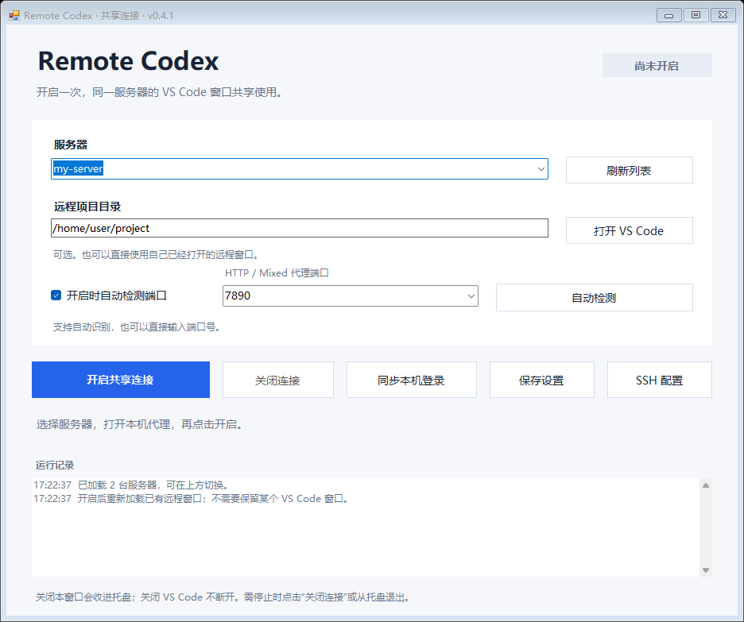

# Remote Codex Switch

Windows 可视化开关：选择 SSH 服务器、识别本机代理端口，按需为远端 VS Code 的 Codex 开启共享连接。

**[下载 v0.4.1](https://github.com/galaaaaaa/remote-codex-switch/releases/tag/v0.4.1)** · [应用源码](src/RemoteCodexApp.cs)



## 使用方法

1. 下载 `RemoteCodex.exe`，可以直接放在桌面，双击运行。无需管理员权限。
2. 打开本机代理软件，选择 `.ssh/config` 中的服务器别名，点击“开启共享连接”。默认会自动检测 HTTP / Mixed 代理端口。
3. 在自己平常使用的 VS Code 远程窗口中执行一次 **Developer: Reload Window / 开发人员: 重新加载窗口**。之后使用 Codex；新开的远程窗口直接读取共享设置。
4. 可以关闭任何 VS Code 窗口，连接会继续保持。本应用右上角关闭按钮和最小化会收进系统托盘。
5. 停止时点击应用的“关闭连接”，或从托盘菜单选择“退出并关闭连接”。双击托盘图标或再次双击桌面程序可以打开面板。

“打开 VS Code”只是方便打开一个普通远程窗口，可填服务器项目绝对路径。开启共享连接不会自动打开编辑器，也不依赖某个编辑窗口的寿命。

电脑需保持运行，本机代理软件需保持开启。休眠、断网、代理退出后需要重新连接。应用不会添加开机启动项。

## 共享范围

- **所选服务器、同一 SSH 登录用户的标准 VS Code Remote - SSH 窗口**共享使用；切换服务器需要先关闭当前连接。
- 本机其他 VS Code 窗口、其他服务器和其他服务器用户不会被自动开启代理。
- 应用临时设置该远端用户的 `http.useLocalProxyConfiguration=false`、`http.proxy` 和 `http.proxySupport`。远端 Codex 扩展及读取这些设置的其他 VS Code 扩展都可能使用代理。
- 不向 `.bashrc`、`.profile` 或普通 SSH 终端注入全局代理，不会强制该用户的所有联网操作走代理。Codex 子命令仍可能继承代理，大文件下载可能消耗节点流量。
- 已启动的 Codex 进程不会自动更换其环境变量，首次开启或代理端口改变后需要重新加载对应窗口。关闭连接后，如果要在原窗口继续尝试直连 Codex，也应重新加载。

这不代表账号一定已登录、节点一定被服务接受或模型请求一定成功。共享连接检查的是服务器通过该隧道能否访问 OpenAI 登录服务。

## 登录同步

本机 Codex 已登录、远端提示登录时，可以单独点击“同步本机登录”：

1. 确认目标服务器是自己信任的服务器。该操作会更换同一远端用户的 Codex 登录，影响该用户的其他 Codex 窗口。
2. 应用读取本机 `CODEX_HOME/auth.json`（默认 `~/.codex/auth.json`），通过 SSH 标准输入发送；凭据不会放进命令参数、日志或 GitHub。
3. 远端已有文件先备份为 `auth.json.remote-codex-switch-backup-*`，新文件原子替换，权限设为 600。
4. 重新加载远端 Codex 面板。同步不是每次启动都会执行的操作。

目前只支持文件方式保存的登录，不会提取系统凭据库中的凭据。远端显式设置 `keyring`、`auto` 或 `ephemeral` 存储时会拒绝文件同步。登录文件及备份都应像密码一样保管。

本应用不配置本机浏览器代理。浏览器登录报 IP 错误和服务器上的 Codex 请求是两段不同连接，需要结合完整错误判断。同步登录可以省去远程浏览器授权步骤，不能修复网络或绕过服务的地区和账号要求。

## 设置恢复和异常断线

远端只管理 `~/.vscode-server/data/Machine/settings.json` 中三个代理设置。启动前保存原值；停止时恢复，并保留其他设置、注释和用户在连接期间的其他修改。如果用户主动更改了应用管理的某个值，恢复时不会覆盖用户的新值。

远端状态保存在当前用户的 `~/.cache/remote-codex-switch/`，目录权限 700，恢复记录权限 600。记录可能包含原 VS Code 设置，应留在本机，不要上传。

连接由后台心跳保持。正常停止发送 STOP；控制进程退出、SSH 输入关闭或 15 秒收不到心跳时，远端恢复设置并结束。远端进程遭到强制终止而来不及恢复时，下次启动先用恢复记录还原旧状态。无法解析的设置文件、符号链接和同一用户的重复连接会被拒绝。

恢复失败时保留恢复记录，不会盲目覆盖整个用户设置。服务器计算任务不因关闭连接而停止。

## 服务器与端口

服务器列表读取本机 `~/.ssh/config` 主文件中的具体 Host 别名。Include 文件中的别名可以手动输入。SSH 登录端口由 SSH 配置决定，与代理端口不同。

自动检测顺序：启用的 Windows HTTP/HTTPS 系统代理、本机代理环境变量、上次端口、已运行的常见代理程序、少量常见端口（7890、7897、10809 等）。使用 HTTP CONNECT 握手区分 HTTP/Mixed 与 SOCKS 端口，不发送账号数据。多个可用候选需要选择。

代理端口变化时，关闭连接后重新开启；不要保留旧端口的连接。自动模式会重新检测。手动模式只确认 TCP 可连接，需要自行确认是无需认证的 HTTP / Mixed 端口。

如果以前按教程设置了常驻代理，应用不会清理 `.bashrc`、原 SSH 配置或其他历史设置。Include 文件中若仍有常驻转发会提示处理；普通 VS Code 连接若有旧的重复 RemoteForward，也应先处理。

## 环境要求与本机文件

- Windows 10/11，.NET Framework 4.8、Windows PowerShell、OpenSSH 客户端。
- 已配置 Remote - SSH，远端标准 VS Code Server 已安装 Codex 扩展；账号需要已有有效登录或单独同步。
- Linux 服务器，Python 3、curl、常见 shell 工具，允许 SSH 远程端口转发。当前使用标准 `~/.vscode-server` 路径；自定义目录、其他编辑器和容器内的 Codex 不会自动覆盖。
- 密钥登录在后台完成。需要 SSH 密码或主机确认时弹出登录窗口；应用不保存 SSH 密码。

程序可以放在桌面或其他目录。配置和后台组件始终保存在 `%LOCALAPPDATA%\RemoteCodexSwitch\`，移动可执行文件不影响已有配置。

源码中的 CMD 脚本仍可使用；脚本版设置保存在源码目录，与可执行应用分开。脚本控制台需保持运行，可视化版可收进托盘。

## 升级

v0.2.0 将连接绑定到专用 VS Code 窗口，且本机 `http.proxy` 可能没有传给远端 Codex。v0.3.0 增加专用启动器与可选登录同步。v0.4.0 改为远端共享设置和后台连接，不再设置开发用途的 `chatgpt.cliExecutable`，也不再创建独立 VS Code 配置。

升级时先退出旧应用，再替换 exe。旧版的专用编辑窗口可以关闭，之后使用自己的普通远程窗口。已有服务器和端口配置会继续读取。

## 构建和验证

```powershell
powershell.exe -NoProfile -ExecutionPolicy Bypass -File .\Build-App.ps1
powershell.exe -NoProfile -ExecutionPolicy Bypass -File .\tests\Test-RemoteCodex.ps1
powershell.exe -NoProfile -ExecutionPolicy Bypass -File .\tests\Test-ProxyDetection.ps1
powershell.exe -NoProfile -ExecutionPolicy Bypass -File .\tests\Test-LoginSync.ps1
python tests/test_shared_settings.py
.\dist\RemoteCodex.exe --self-test .\.test-artifacts\gui
```

Linux 上可运行 `python3 tests/test_login_sync_remote.py`。仓库测试只使用临时目录、模拟进程与虚构凭据，不读取真实登录文件。验证连接独立于编辑器、正常/异常关闭、SSH stdin 同步、JSONC 注释保护、恢复与连接期间的用户修改保护。

构建只使用 Windows 自带 .NET 编译器，所有后台组件嵌入 exe。真实服务器测试另验证了共享代理开启、登录服务可达、正常停止和强制断开后的原设置恢复；账号登录和模型请求仍需在用户自己的 Codex 面板确认。

## 参考

- [VS Code 远程设置与覆盖顺序](https://code.visualstudio.com/docs/remote/ssh#_ssh-hostspecific-settings)
- [VS Code 代理配置实现及作用域](https://github.com/microsoft/vscode/blob/main/src/vs/platform/request/common/request.ts)
- [OpenAI：登录缓存与远程设备登录](https://learn.chatgpt.com/docs/auth)
